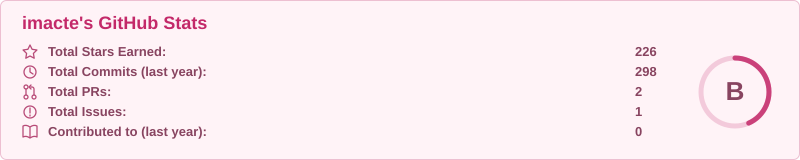
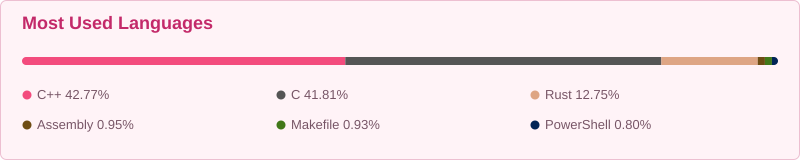
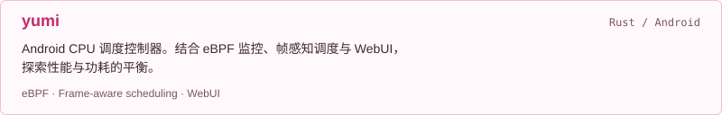
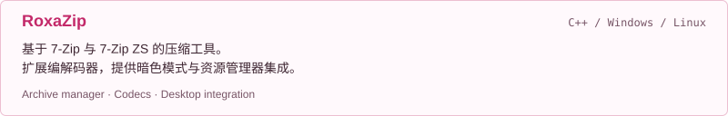
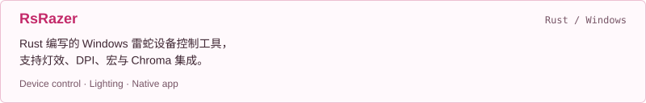

<!-- 图片由 scripts/generate-profile.mjs 生成；部署和维护见 MAINTENANCE.md。 -->

  <picture>
    <source media="(max-width: 600px) and (prefers-color-scheme: dark)" srcset="./assets/header-mobile-dark.svg">
    <source media="(max-width: 600px) and (prefers-color-scheme: light)" srcset="./assets/header-mobile-light.svg">
    <source media="(prefers-color-scheme: dark)" srcset="./assets/header-dark.svg">
    <source media="(prefers-color-scheme: light)" srcset="./assets/header-light.svg">
    
  </picture>

  <a href="https://github.com/imacte">@imacte</a> ·
  <a href="https://github.com/imacte?tab=repositories">Explore my repositories ↗</a>

  <picture>
    <source media="(max-width: 600px) and (prefers-color-scheme: dark)" srcset="./assets/stats-mobile-dark.svg">
    <source media="(max-width: 600px) and (prefers-color-scheme: light)" srcset="./assets/stats-mobile-light.svg">
    <source media="(prefers-color-scheme: dark)" srcset="./assets/stats-dark.svg">
    <source media="(prefers-color-scheme: light)" srcset="./assets/stats-light.svg">
    
  </picture>

  <picture>
    <source media="(max-width: 600px) and (prefers-color-scheme: dark)" srcset="./assets/languages-mobile-dark.svg">
    <source media="(max-width: 600px) and (prefers-color-scheme: light)" srcset="./assets/languages-mobile-light.svg">
    <source media="(prefers-color-scheme: dark)" srcset="./assets/languages-dark.svg">
    <source media="(prefers-color-scheme: light)" srcset="./assets/languages-light.svg">
    
  </picture>

Public repository stats · <a href="https://github.com/stats-organization/github-stats-extended">GitHub Stats Extended</a>

### 关于我 · About me

我是 **imacte**，这里记录我围绕系统性能、原生应用与实用工具的开发实践。

- **Android 性能** — CPU 调度、eBPF 监控与能效优化。
- **原生工具** — 用 Rust 构建设备控制与桌面应用。
- **使用体验** — 让配置管理、桌面集成和日常操作更顺手。

### 精选项目 · Selected projects

<a href="https://github.com/imacte/yumi">
  <picture>
    <source media="(max-width: 600px) and (prefers-color-scheme: dark)" srcset="./assets/project-yumi-mobile-dark.svg">
    <source media="(max-width: 600px) and (prefers-color-scheme: light)" srcset="./assets/project-yumi-mobile-light.svg">
    <source media="(prefers-color-scheme: dark)" srcset="./assets/project-yumi-dark.svg">
    <source media="(prefers-color-scheme: light)" srcset="./assets/project-yumi-light.svg">
    
  </picture>
</a>

<a href="https://github.com/imacte/RoxaZip">
  <picture>
    <source media="(max-width: 600px) and (prefers-color-scheme: dark)" srcset="./assets/project-roxazip-mobile-dark.svg">
    <source media="(max-width: 600px) and (prefers-color-scheme: light)" srcset="./assets/project-roxazip-mobile-light.svg">
    <source media="(prefers-color-scheme: dark)" srcset="./assets/project-roxazip-dark.svg">
    <source media="(prefers-color-scheme: light)" srcset="./assets/project-roxazip-light.svg">
    
  </picture>
</a>

<a href="https://github.com/imacte/RsRazer">
  <picture>
    <source media="(max-width: 600px) and (prefers-color-scheme: dark)" srcset="./assets/project-rsrazer-mobile-dark.svg">
    <source media="(max-width: 600px) and (prefers-color-scheme: light)" srcset="./assets/project-rsrazer-mobile-light.svg">
    <source media="(prefers-color-scheme: dark)" srcset="./assets/project-rsrazer-dark.svg">
    <source media="(prefers-color-scheme: light)" srcset="./assets/project-rsrazer-light.svg">
    
  </picture>
</a>

---

欢迎通过项目 Issues，交流使用体验和新想法。

  <a href="https://github.com/imacte/yumi/issues">yumi Issues ↗</a> ·
  <a href="https://github.com/imacte/RoxaZip/issues">RoxaZip Issues ↗</a> ·
  <a href="https://github.com/imacte/RsRazer/issues">RsRazer Issues ↗</a>

Thanks for stopping by. ✦

